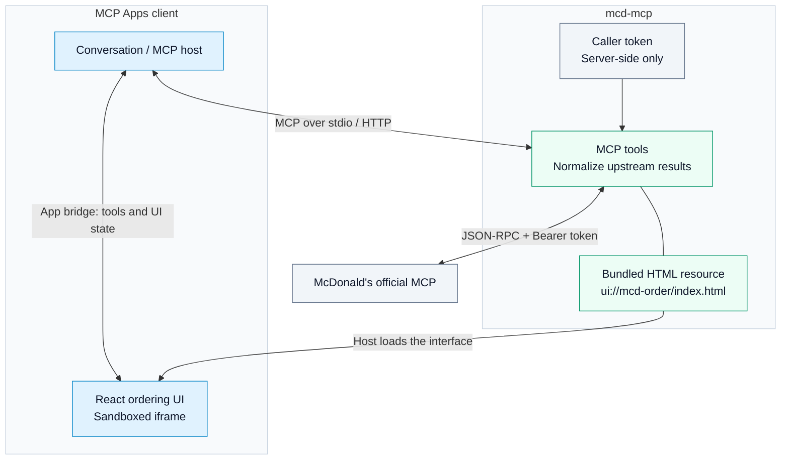
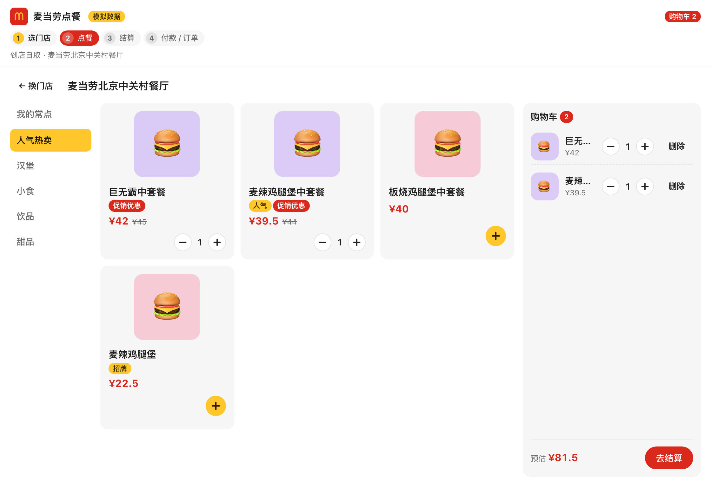
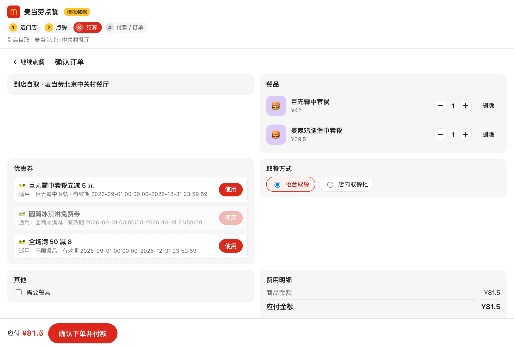

# McDonald's Ordering MCP App

[English](README.md) | [简体中文](README.zh.md)

Browse the menu, customize meals, apply coupons and follow your order inside an MCP Apps client. `@dumbo-ai/mcd-mcp` adds a React ordering interface to the [McDonald's China MCP service](https://open.mcd.cn/mcp).

## Architecture



The host loads the bundled UI and forwards its tool calls to this server. Store search, menu browsing and checkout happen in the interface without another model turn. See [MCP Apps](https://modelcontextprotocol.io/extensions/apps/overview) for the host protocol.

**Order flow:** choose pickup, delivery or drive-through → select a store → add meals → review coupons and price → confirm the order → pay in the McDonald's app → track the order.

## Screenshots

Captured from the actual UI with built-in mock data and placeholder food images. Prices and stores are examples; no real order was placed.

**Menu and shopping cart**



**Checkout**



## Quick start

You need **Node.js 20+**, a client that supports MCP Apps, and a token from the [McDonald's MCP platform](https://open.mcd.cn/mcp).

Add this entry to your client's MCP configuration:

```json
{
  "mcpServers": {
    "mcd-order": {
      "command": "npx",
      "args": ["-y", "@dumbo-ai/mcd-mcp", "--stdio"],
      "env": { "MCD_MCP_TOKEN": "your-token" }
    }
  }
}
```

Then ask the assistant to open McDonald's ordering, for example: “帮我点个麦当劳”. The ordering UI is currently in Chinese.

To preview without an account, replace the `env` object with `{ "MCD_MOCK": "1" }`. This uses local sample data and does not call McDonald's.

You can also install once with `npm install -g @dumbo-ai/mcd-mcp`, then use `"command": "mcd-mcp"` and `"args": ["--stdio"]`. If the client cannot find the command, use its absolute path.

## What you can do

| Step             | In the app                                                                                        |
| ---------------- | ------------------------------------------------------------------------------------------------- |
| Select a store   | Pickup, delivery or drive-through; saved delivery addresses and address creation                  |
| Build a meal     | Menu categories, prices, promotions, combo substitutions and ingredient choices                   |
| Review checkout  | Coupons, utensils, notes, delivery fees and the price returned by the official service            |
| Pay              | Confirm the order and scan the payment QR code to continue in the McDonald's app                  |
| Follow the order | Automatically refreshed status, pickup or delivery information, and cancellation of unpaid orders |

The UI follows the host's light/dark theme and adapts to the available width. On hosts that support `updateModelContext`, it shares the selected store, cart and order state with the assistant.

A client without MCP Apps rendering receives tool results but cannot display this interface. App-only tools depend on the host honoring their visibility metadata; the server does not enforce a separate UI-only authorization check.

## Tools

| Tool                       | Visibility  | Purpose                                                                |
| -------------------------- | ----------- | ---------------------------------------------------------------------- |
| `mcd-order`                | Model + app | Open the interface; optionally prefill mode, city, keyword or order ID |
| `query-nearby-stores`      | Model + app | Find pickup or drive-through stores                                    |
| `delivery-query-addresses` | Model + app | List saved delivery addresses                                          |
| `delivery-query-stores`    | Model + app | Find stores for a delivery address                                     |
| `query-meals`              | Model + app | Read the store menu                                                    |
| `query-meal-detail`        | Model + app | Read combo choices and ingredients                                     |
| `query-store-coupons`      | Model + app | List applicable coupons                                                |
| `calculate-price`          | Model + app | Request an official price quote                                        |
| `query-order`              | Model + app | Read order status and pickup/delivery information                      |
| `delivery-create-address`  | App only    | Save a delivery address                                                |
| `create-order`             | App only    | Create an order and return the payment link                            |
| `cancel-order`             | App only    | Cancel an unpaid order                                                 |

## Configuration and HTTP hosting

| Variable        | Purpose                                                      |
| --------------- | ------------------------------------------------------------ |
| `MCD_MCP_TOKEN` | Account token for stdio mode and the probe script            |
| `MCD_MOCK`      | Set to `1` to use built-in mock data                         |
| `MCD_MCP_URL`   | Optional upstream override; defaults to `https://mcp.mcd.cn` |
| `PORT`          | HTTP listen port; defaults to `3001`                         |

The server does not load `.env` automatically. Set variables in your shell or client configuration; see [.env.example](.env.example).

Without `--stdio`, the server exposes Streamable HTTP at `/mcp` and a health check at `/healthz`. After a global install:

```sh
mcd-mcp
```

Connect an HTTP-capable client to `http://localhost:3001/mcp`. **Each HTTP request must carry the caller's own token**, read in this order: `x-mcd-token` header → `?token=` query parameter → `Authorization: Bearer`. HTTP mode does not fall back to `MCD_MCP_TOKEN`. Prefer headers when supported, since query parameters can appear in access logs. Tokens are used by the server, not passed to the UI or model.

## Development

```sh
git clone https://github.com/dumboai-studio/mcd-mcp.git
cd mcd-mcp
npm install
npm run check
MCD_MOCK=1 npm start
```

`npm run check` typechecks and builds the React UI into a single HTML resource, then compiles the server. `npm run dev` watches both. To connect a client to a local build, use `node` with `["/absolute/path/mcd-mcp/dist/server/main.js", "--stdio"]`. Avoid `npm run start:stdio` as the client's launch command because npm output can interfere with stdio messages.

For raw upstream responses, use `npm run probe -- query-nearby-stores '{"searchType":1,"beType":1}'` with `MCD_MCP_TOKEN` set. For a development host, see the [official MCP Apps basic-host example](https://github.com/modelcontextprotocol/ext-apps/tree/main/examples/basic-host).

Source: [tools and UI resource](server/server.ts) · [upstream client](server/mcd-client.ts) · [UI flow](ui/src/Shell.tsx) · [mock data](server/mock.ts).

## License and affiliation

[MIT](LICENSE). This is an independent, unofficial client, not affiliated with or endorsed by McDonald's. McDonald's names, logos and brand assets belong to their owners and are not covered by this project's license. Obtain your own token and follow the official service's terms.
