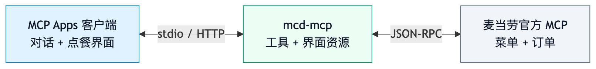
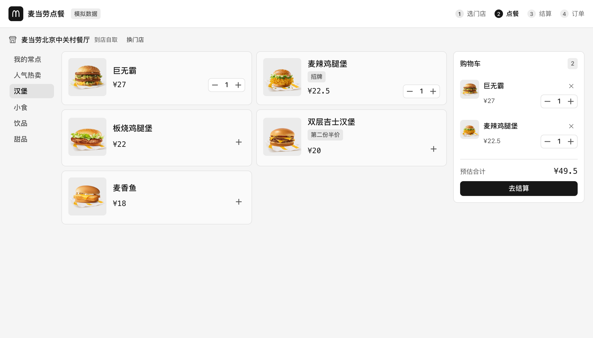
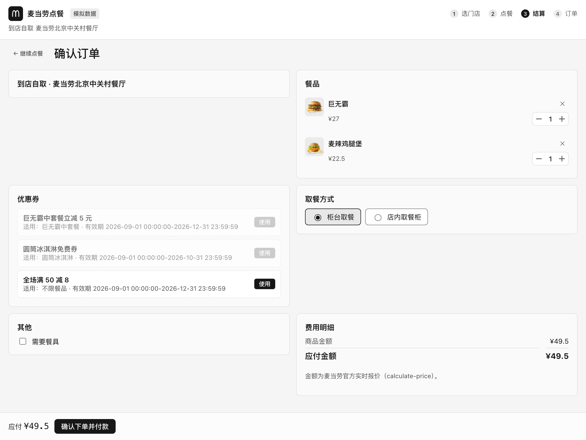

# 麦当劳点餐 MCP App

[English](README.md) | [简体中文](README.zh.md)

在 MCP Apps 客户端里浏览菜单、定制套餐、选券结算和查看订单。`@dumbo-ai/mcd-mcp` 在[麦当劳中国官方 MCP 服务](https://open.mcd.cn/mcp)之上提供 React 点餐界面。

## 架构



客户端加载随服务提供的界面，并把界面的工具调用转给本服务。选店、浏览菜单和结算都可以直接点击完成，不需要反复与模型对话。宿主协议见 [MCP Apps](https://modelcontextprotocol.io/extensions/apps/overview)。

**点餐流程：** 选择自取、外送或得来速 → 选门店 → 加购餐品 → 核对优惠券和价格 → 确认下单 → 在麦当劳 App 付款 → 查看订单。

## 界面截图

实际界面截图，商品图片来自[麦当劳官网](https://www.mcdonalds.com.cn/product/mcdonalds/)；价格和门店使用演示数据。

**菜单与购物车**



**结算**



## 快速开始

需要 **Node.js 20+**、支持 MCP Apps 的客户端，以及在[麦当劳 MCP 平台](https://open.mcd.cn/mcp)申请的 Token。

把下面的条目加入客户端的 MCP 配置：

```json
{
  "mcpServers": {
    "mcd-order": {
      "command": "npx",
      "args": ["-y", "@dumbo-ai/mcd-mcp", "--stdio"],
      "env": { "MCD_MCP_TOKEN": "替换为你的 Token" }
    }
  }
}
```

然后在对话里说「帮我点个麦当劳」即可。点餐界面目前使用中文。

没有 Token 也可以先体验：把 `env` 换成 `{ "MCD_MOCK": "1" }`，就会使用本地模拟数据，不请求麦当劳服务。

也可以先运行 `npm install -g @dumbo-ai/mcd-mcp` 全局安装，再将配置改为 `"command": "mcd-mcp"` 和 `"args": ["--stdio"]`。客户端找不到命令时，填写命令的绝对路径。

## 支持的功能

| 环节     | 可以做什么                                           |
| -------- | ---------------------------------------------------- |
| 选门店   | 自取、外送或得来速；选择已有配送地址或新增地址       |
| 点餐     | 浏览分类、价格和促销；套餐换品、调整配料             |
| 结算     | 选优惠券、餐具、备注，核对配送费和官方返回的应付金额 |
| 支付     | 确认下单后扫码，进入麦当劳 App 付款                  |
| 查看订单 | 自动刷新状态、取餐或配送信息，取消待付款订单         |

界面采用紧凑的黑白灰布局，跟随客户端的浅色或深色主题，并适应容器宽度。客户端支持 `updateModelContext` 时，会把门店、购物车和订单状态同步给模型。

客户端需要支持 MCP Apps 才能显示界面；只支持文本时仅能收到工具结果。「仅界面可用」是交给客户端遵守的工具可见性声明，服务端没有额外校验调用是否来自界面。

## 工具清单

| 工具                       | 可见性      | 用途                                           |
| -------------------------- | ----------- | ---------------------------------------------- |
| `mcd-order`                | 模型 + 界面 | 打开界面，可预填点餐方式、城市、关键词或订单号 |
| `query-nearby-stores`      | 模型 + 界面 | 查询自取或得来速门店                           |
| `delivery-query-addresses` | 模型 + 界面 | 查询配送地址                                   |
| `delivery-query-stores`    | 模型 + 界面 | 按地址查询外送门店                             |
| `query-meals`              | 模型 + 界面 | 查询门店菜单                                   |
| `query-meal-detail`        | 模型 + 界面 | 查询套餐组成和配料                             |
| `query-store-coupons`      | 模型 + 界面 | 查询可用优惠券                                 |
| `calculate-price`          | 模型 + 界面 | 获取官方报价                                   |
| `query-order`              | 模型 + 界面 | 查询订单、取餐或配送信息                       |
| `delivery-create-address`  | 仅界面      | 新增配送地址                                   |
| `create-order`             | 仅界面      | 创建订单并返回支付链接                         |
| `cancel-order`             | 仅界面      | 取消待付款订单                                 |

## 配置与 HTTP 部署

| 环境变量        | 用途                                    |
| --------------- | --------------------------------------- |
| `MCD_MCP_TOKEN` | stdio 模式和 probe 脚本使用的账号 Token |
| `MCD_MOCK`      | 设为 `1` 时使用内置模拟数据             |
| `MCD_MCP_URL`   | 可选上游地址，默认 `https://mcp.mcd.cn` |
| `PORT`          | HTTP 端口，默认 `3001`                  |

服务不会自动加载 `.env`，请在终端或客户端配置里设置环境变量，示例见 [.env.example](.env.example)。

不加 `--stdio` 时，服务通过 `/mcp` 提供 Streamable HTTP，并提供 `/healthz` 健康检查。全局安装后运行：

```sh
mcd-mcp
```

支持 HTTP 的客户端连接 `http://localhost:3001/mcp`。**每次请求都需要携带调用者自己的 Token**，读取顺序为 `x-mcd-token` 请求头 → `?token=` 查询参数 → `Authorization: Bearer`。HTTP 模式不回退到 `MCD_MCP_TOKEN`。能用请求头就优先用请求头，因为查询参数可能出现在访问日志中。Token 只供服务端使用，不传给界面或模型。

## 开发

```sh
git clone https://github.com/dumboai-studio/mcd-mcp.git
cd mcd-mcp
npm install
npm run check
MCD_MOCK=1 npm start
```

`npm run check` 执行类型检查，将 React 界面打包为单个 HTML 资源，并编译服务端。`npm run dev` 监听两端改动。本地构建后，客户端可使用 `node` 启动，参数填 `["/absolute/path/mcd-mcp/dist/server/main.js", "--stdio"]`。不要用 `npm run start:stdio` 作为客户端启动命令，npm 的输出可能干扰 stdio 协议。

要查看上游原始返回，设置 `MCD_MCP_TOKEN` 后运行 `npm run probe -- query-nearby-stores '{"searchType":1,"beType":1}'`。调试宿主可参考[官方 MCP Apps basic-host 示例](https://github.com/modelcontextprotocol/ext-apps/tree/main/examples/basic-host)。

源码入口：[工具和界面资源](server/server.ts) · [上游客户端](server/mcd-client.ts) · [界面流程](ui/src/Shell.tsx) · [模拟数据](server/mock.ts)。

## 许可与项目关系

[MIT](LICENSE)。本项目是独立的非官方客户端，与麦当劳无关联，未获其授权或认可。麦当劳名称、标识和品牌资产归其所有，不属于本项目许可范围。请自行申请 Token 并遵守官方服务条款。
